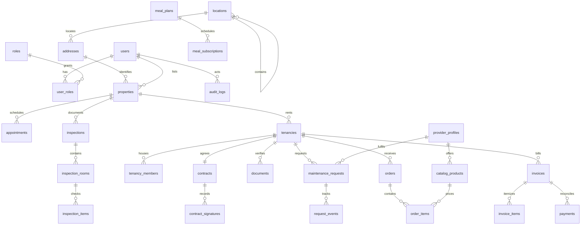

# Database design

Identity, location, rentals, inspections, commerce and billing are separate relational domains. Each record uses a primary key; cross-domain records use foreign keys rather than copied names. Status changes and audit events preserve operational history.

`v_property_locations` reconstructs division → district → area → sub-area and the exact road, house, floor and flat. Admin location management can extend this hierarchy beyond the seeded Dhaka pilot areas.

`v_invoice_balances` first aggregates invoice lines and confirmed payments independently. This avoids double-counting when one invoice has multiple charge lines and multiple payments. `DECIMAL(12,2)` stores money; final totals are computed in SQL.

`v_cost_reconciliation` compares provider price against the responsible customer's price. Maintenance cannot be added to an invoice twice because `invoice_items.request_id` is unique. Orders likewise use a unique invoice reference.

Monthly invoices are unique per tenancy, user, month and billing group. Immediate installation/grocery/service orders receive an order-specific group; deferred groceries, meals and repairs join the monthly group. Separate owner and tenant payer records keep responsibility explicit.

Payment records have separate reviewer and confirmer foreign keys. The API locks payment and invoice records, rejects excess payments, and prevents the same user from performing both approval steps. Only confirmed payments affect outstanding balances.

Private document metadata links to its uploading user and optionally its property and tenancy. Random storage paths stay outside `dist`, and downloads require an authorized session. Actual property photographs may be served publicly only for published listings.

Instance data stays in `storage/mysql`. The normal app account has business-database DML permissions; root is used only for setup/migration and local phpMyAdmin administration. `schema.sql` and `queries.sql` are importable in phpMyAdmin and can be used with a separately hosted MySQL instance by updating the private config.
